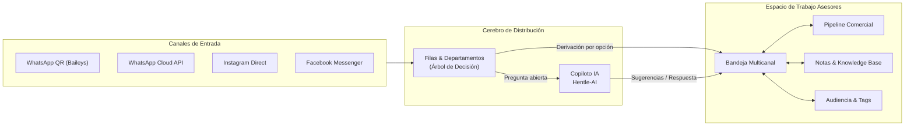
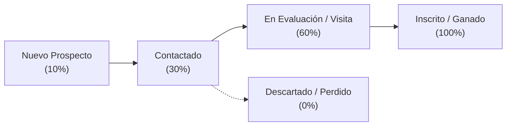
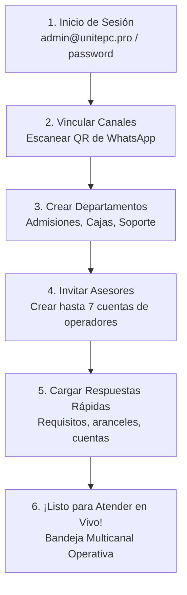

# Manual de Operación y Referencia Integral
## XpertiFlow CRM — Omnichannel Suite Pro V2

> **Versión del Sistema:** V2.4 Enterprise  
> **Fecha de Emisión:** Octubre 2026  
> **Plataforma:** Omnichannel Contact Center & CRM Conversacional Multi-Tenant con Hentle-AI  

---

## Tabla de Contenidos

1. [Visión General de la Suite y Arquitectura](#1-visión-general-de-la-suite-y-arquitectura)
2. [Estructura de Roles y Niveles de Acceso](#2-estructura-de-roles-y-niveles-de-acceso)
3. [Módulo 1: Dashboard y Métricas Operativas](#módulo-1-dashboard-y-métricas-operativas)
4. [Módulo 2: Bandeja Multicanal (Live Chat Inbox)](#módulo-2-bandeja-multicanal-live-chat-inbox)
5. [Módulo 3: Canales & Conexiones (WhatsApp QR y Cloud API)](#módulo-3-canales--conexiones-whatsapp-qr-y-cloud-api)
6. [Módulo 4: Pipeline Comercial & Tableros Kanban](#módulo-4-pipeline-comercial--tableros-kanban)
7. [Módulo 5: Respuestas Rápidas (Snippets y Atajos)](#módulo-5-respuestas-rápidas-snippets-y-atajos)
8. [Módulo 6: Notas & Base de Conocimiento (IA Assist)](#módulo-6-notas--base-de-conocimiento-ia-assist)
9. [Módulo 7: Contactos & Audiencia](#módulo-7-contactos--audiencia)
10. [Módulo 8: Etiquetas & Segmentación](#módulo-8-etiquetas--segmentación)
11. [Módulo 9: Campañas Masivas](#módulo-9-campañas-masivas)
12. [Módulo 10: Envíos Programados](#módulo-10-envíos-programados)
13. [Módulo 11: Empresas & Cuentas B2B](#módulo-11-empresas--cuentas-b2b)
14. [Módulo 12: Operadores & Equipo](#módulo-12-operadores--equipo)
15. [Módulo 13: Filas & Departamentos (Enrutamiento Inteligente)](#módulo-13-filas--departamentos-enrutamiento-inteligente)
16. [Módulo 14: Reportes, Métricas & Auditoría CSAT](#módulo-14-reportes-métricas--auditoría-csat)
17. [Módulo 15: Parametrización & Estados Personalizados](#módulo-15-parametrización--estados-personalizados)
18. [Módulo 16: Inteligencia Artificial (Hentle-AI & Wabot)](#módulo-16-inteligencia-artificial-hentle-ai--wabot)
19. [Módulo 17: Planes & Precios](#módulo-17-planes--precios)
20. [Módulo 18: Centro de Control SuperAdmin SaaS (Master)](#módulo-18-centro-de-control-superadmin-saas-master)
21. [Módulo 19: Mi Cuenta, Preferencias & Presencia de Operador](#módulo-19-mi-cuenta-preferencias--presencia-de-operador)
22. [Módulo 20: Tokens de API & Integraciones OpenAPI](#módulo-20-tokens-de-api--integraciones-openapi)
23. [Módulo 21: Centro de Ayuda & Guía Interactiva en Navbar (💡)](#módulo-21-centro-de-ayuda--guía-interactiva-en-navbar-)
24. [Guía de Onboarding Rápido para Nuevas Empresas (Caso UNITEPC)](#guía-de-onboarding-rápido-para-nuevas-empresas-caso-unitepc)

---

## 1. Visión General de la Suite y Arquitectura

**XpertiFlow CRM V2** es una solución omnicanal de nivel empresarial construida para transformar canales conversacionales (WhatsApp, Instagram DM, Facebook Messenger) en procesos estructurados de ventas, atención al cliente y soporte 24/7.

### Pilares Fundamentales
1. **Multi-Tenancy Estricto:** Cada empresa cliente (ejemplo: UNITEPC) opera en un entorno 100% aislado. Sus contactos, mensajes, operadores y configuraciones son invisibles para cualquier otra organización.
2. **Persistencia Garantizada:** Las sesiones QR de WhatsApp, archivos multimedia (audios, fotos, PDFs) y la base de datos PostgreSQL residen en volúmenes Docker permanentes que resisten reinicios y actualizaciones sin pérdida de datos.
3. **Copiloto Hentle-AI:** Inteligencia artificial generativa con soporte de embeddings vectoriales para respuestas instantáneas, resúmenes automáticos de conversaciones y corrección ortográfica en tiempo real.

---

## 2. Estructura de Roles y Niveles de Acceso

El sistema maneja una jerarquía clara de permisos y discriminación estricta de vistas para salvaguardar la privacidad y la seguridad operativa:

| Rol | Ámbito | Visibilidad y Menús Asignados |
| :--- | :--- | :--- |
| **SuperAdmin (Master)** | Global (SaaS) | Acceso exclusivo al portal SaaS (`/app/superadmin`), facturación global, MRR, concesión de licencias, prórroga de períodos de prueba y control de cuotas (*Usuario: `admin@crm.local`*). |
| **Owner / Administrador** | Organización | Acceso total a los bloques de **Operación** y **Gestión & Configuración**: vincula canales de WhatsApp, parametriza sedes/carreras, gestiona operadores, define horarios de atención y analiza reportes de rendimiento. |
| **Supervisor** | Organización | Monitorea conversaciones de los asesores, revisa métricas de SLA, interviene en chats en modo fantasma o reasigna colas de atención. |
| **Asesor / Operador** | Filas / Canales | Acceso **exclusivo al bloque de Operación** (Bandeja Multicanal, Pipeline Kanban, Respuestas Rápidas, Notas, Contactos y Etiquetas). Los menús de configuración están completamente ocultos y blindados por router y API. |

### Segmentación Visual del Menú Lateral
1. **Bloque Operación (Todos los usuarios):**
   * Dashboard, Bandeja Multicanal, Pipeline Comercial, Respuestas Rápidas, Notas & Conocimiento, Contactos & Audiencia, Etiquetas & Segmentos.
2. **Bloque Gestión & Configuración (Solo Administradores):**
   * Canales & Conexiones, Parametrización, Operadores & Equipo, Filas & Departamentos, Campañas Masivas, Envíos Programados, Empresas & Cuentas, Reportes & Métricas, Inteligencia Artificial, Planes & Precios.
3. **Bloque Master SaaS (Solo SuperAdmin Global):**
   * Portal SuperAdmin SaaS.

> [!IMPORTANT]
> Si un operador intenta ingresar directamente a una ruta de gestión mediante la URL del navegador (ej. `/app/parameters` o `/app/users`), el sistema lo redirige de forma automática a la **Bandeja Multicanal** (`/app/conversations`). Además, el backend rechaza cualquier petición no autorizada con código **HTTP 403 Forbidden**.

---

## Módulo 1: Dashboard y Métricas Operativas

* **Ruta de acceso:** `/app/dashboard`
* **Audiencia:** Administradores, Supervisores y Asesores.

### Propósito
Proporcionar una vista panorámica en tiempo real del pulso comercial y operativo del centro de contacto.

### Métricas Clave (KPIs)
* **Tickets Abiertos / En Espera:** Cantidad de clientes esperando respuesta en este momento.
* **Tiempo Promedio de Primera Respuesta (FRT):** Minutos que transcurren desde que el cliente escribe hasta que un asesor toma el chat.
* **Tiempo Medio de Resolución (MTTR):** Duración total desde la apertura del ticket hasta su cierre definitivo.
* **Índice de Satisfacción (CSAT):** Calificación porcentual obtenida de las encuestas automáticas post-atención.
* **Gráfica de Tráfico Horario:** Mapa de calor que identifica las horas pico de mensajes para dimensionar turnos de operadores.

> [!TIP]
> Los administradores pueden filtrar el Dashboard por rango de fechas (Hoy, Últimos 7 días, Este mes) y por canales específicos de WhatsApp.

---

## Módulo 2: Bandeja Multicanal (Live Chat Inbox)

* **Ruta de acceso:** `/app/conversations`
* **Audiencia:** Todos los operadores y supervisores.

### Interfaz de Tres Columnas
1. **Columna Izquierda (Lista de Chats):**
   * Pestañas de estado: *Abiertos*, *Mis Chats*, *En Espera*, *Resueltos*.
   * Buscador por nombre de contacto, número de teléfono o contenido del mensaje.
   * Filtro por Etiquetas, Filas de atención y Estado de Lead.
2. **Columna Central (Ventana de Conversación):**
   * Historial cronológico continuo con doble check de lectura (✓✓ azul/gris).
   * Soporte nativo para: texto, notas de voz (audios reproducibles con acelerador 1.5x/2x), imágenes, documentos PDF, stickers y ubicaciones.
   * **Caja de Respuesta Inferior:**
     * Escribe `/` para desplegar el menú de **Mensajes Rápidos**.
     * Botón de **Notas del Sistema (📝)** para consultar la Base de Conocimiento y copiar contenido con 1 clic.
     * Botón **Corregir con IA** para pulir ortografía y redacción ejecutiva antes de enviar.
     * Envío de mensaje privado interno (modo nota amarilla solo visible entre agentes).
3. **Columna Derecha (Ficha 360° del Contacto):**
   * Datos del cliente: teléfono, correo, campus o facultad.
   * Pipeline actual y etapa comercial con selector rápido para mover de etapa.
   * Asignación de Operador responsable y Fila/Departamento.
   * Botón de resolución o cierre del ticket con envío opcional de encuesta CSAT.

---

## Módulo 3: Canales & Conexiones (WhatsApp QR y Cloud API)

* **Ruta de acceso:** `/app/whatsapp`
* **Audiencia:** Administradores.

### Tipos de Conexión Soportados
1. **WhatsApp Web QR (Motor Baileys Pro):**
   * Permite conectar cualquier número de teléfono convencional o WhatsApp Business sin costos por mensaje de Meta.
   * **Flujo de Conexión:**
     1. Clic en **"+ Nueva Conexión"**.
     2. Seleccionar tipo **"WhatsApp Web QR"**.
     3. Asignar un nombre identificador (ej. *Admisiones Central*).
     4. Escanear el código QR que aparece en pantalla con la app de WhatsApp del celular (*Dispositivos vinculados > Vincular un dispositivo*).
     5. El estado cambiará a **Conectado** en verde.
2. **WhatsApp Cloud API (Meta Oficial):**
   * Conexión por API oficial para volúmenes masivos con plantilla aprobada por Meta. Requiere `Phone Number ID` y `Permanent Access Token`.

> [!IMPORTANT]
> Una vez vinculado el canal por QR, la sesión se almacena en el volumen persistente `baileys_data`. Puedes reiniciar o actualizar el servidor y la conexión **no se perderá**.

---

## Módulo 4: Pipeline Comercial & Tableros Kanban

* **Ruta de acceso:** `/app/deals`
* **Audiencia:** Asesores de Ventas, Admisiones y Coordinadores.

### Funcionamiento
Permite visualizar a los prospectos como tarjetas arrastrables (*Drag & Drop*) a través de las distintas etapas del ciclo de conversión:

* **Vistas:** Tablero Kanban por columnas o Vista de Lista tabular.
* **Mover Oportunidades:** Arrastra la tarjeta a la siguiente fase o cambia la etapa directamente desde el lateral derecho del chat.
* **Métricas de Embudo:** Cada columna calcula automáticamente el valor monetario acumulado y la probabilidad de cierre.

---

## Módulo 5: Respuestas Rápidas (Snippets y Atajos)

* **Ruta de acceso:** `/app/quick-messages`
* **Audiencia:** Todos los operadores y administradores.

### Configuración de Atajos
Permite registrar plantillas de texto reutilizables para responder preguntas frecuentes en segundos sin teclear todo el texto.

* **Ejemplo de Atajo:** `/requisitos`
* **Contenido:**
  > *"Los requisitos para la inscripción al semestre 2026 son: 1. Fotocopia de Cédula de Identidad, 2. Certificado de Nacimiento original, 3. Diploma de Bachiller legalizado."*
* **Uso en el Chat:** En cualquier conversación, el asesor escribe `/` y el buscador inteligente filtra las respuestas disponibles. Al presionar `Enter`, el texto se inserta en la caja de redacción.

---

## Módulo 6: Notas & Base de Conocimiento (IA Assist)

* **Ruta de acceso:** `/app/notes`
* **Audiencia:** Todo el equipo (con permisos de visibilidad configurables por el Admin).

### Características Principales
1. **Repositorio Institucional de Información:** Centraliza precios, fechas de exámenes, protocolos de convalidación, cuentas bancarias autorizadas y manuales de procedimiento.
2. **Categorización Inteligente:** Cada nota se vincula a Categorías (ej. *Medicina*, *Ingeniería*, *Aranceles*) y a Estados de Lead.
3. **Asistente IA Integrado:**
   * **Ajustar con IA:** Reescribe notas en tono comercial persuasivo, ejecutivo o de soporte formal.
   * **Revisar Ortografía:** Corrige acentuación, puntuación y sintaxis automáticamente.
4. **Invocación Rápida desde el Chat:** Los asesores pueden abrir el cajón lateral de Notas dentro de cualquier conversación activa y copiar la información directamente al cliente.

---

## Módulo 7: Contactos & Audiencia

* **Ruta de acceso:** `/app/contacts`
* **Audiencia:** Operadores, Supervisores y Administradores.

### Gestión de Base de Datos de Contactos
* **Creación Automática:** Cada persona que escribe por primera vez a cualquiera de los canales de WhatsApp se registra automáticamente como nuevo contacto.
* **Importación Masiva (CSV / Excel):** Permite subir bases de datos de prospectos con asignación inmediata de etiquetas.
* **Historial Unificado:** Permite ver todos los tickets pasados, notas privadas, sede, carrera y estado del lead a lo largo del tiempo.

### Descarga Avanzada de Selecciones (Excel .xlsx y Reporte PDF)
El sistema incluye un potente motor de exportación para generar informes inmediatos:
1. **Selección Flexible:** Marca casillas individuales o haz clic en *Seleccionar Todos* los contactos de la vista actual.
2. **Descarga en Excel (.xlsx):**
   * Genera una hoja de cálculo con columnas completas y formateadas: Nombre, Teléfono internacional, Correo, Sede Regional, Carrera, Estado del Lead, Asesor Asignado y Fecha de Creación.
   * Ideal para cruces con sistemas académicos, ERPs o reportes de admisión.
3. **Generación de Reporte Ejecutivo en PDF:**
   * Crea un documento imprimible con diseño corporativo, encabezado institucional con logo, fecha y usuario emisor.
   * Incluye un **resumen de KPIs en la cabecera** (Total de prospectos seleccionados, desglose por Sede y desglose por Estado).
   * Tabla paginada limpia y legible con numeración de páginas (ej. *Página 1 de 4*).

---

## Módulo 8: Etiquetas & Segmentación

* **Ruta de acceso:** Dentro de `/app/contacts` o en la barra lateral del chat.
* **Audiencia:** Todos los operadores.

### Utilidad
Las etiquetas permiten marcar a los clientes con distintivos de colores para una segmentación rápida:
* *Ejemplos:* `Postulante 2026`, `Pregrado`, `Posgrado`, `WhatsApp`, `Prioridad Alta`, `En Espera de Documentos`.
* Permiten filtrar la bandeja multicanal para que un asesor trabaje, por ejemplo, únicamente con prospectos que tengan la etiqueta `Prioridad Alta`.

---

## Módulo 9: Campañas Masivas

* **Ruta de acceso:** `/app/campaigns`
* **Audiencia:** Administradores y Coordinadores de Marketing.

### Funcionamiento de Envíos Masivos
Permite enviar comunicados o promociones a listas segmentadas de contactos por WhatsApp:
1. **Creación de Campaña:** Definir nombre, canal de WhatsApp emisor y mensaje.
2. **Selección de Audiencia:** Filtrar por etiquetas (ej. todos los contactos con la etiqueta `Postulante 2026`).
3. **Temporizador Anti-Ban:** El sistema aplica intervalos inteligentes de pausa entre mensaje y mensaje (delay aleatorio configurable de 5 a 15 segundos) para proteger la línea y evitar sanciones por spam de Meta.
4. **Monitoreo de Entrega:** Barra de progreso en vivo que reporta mensajes enviados, entregados y fallidos.

---

## Módulo 10: Envíos Programados

* **Ruta de acceso:** `/app/scheduled-messages`
* **Audiencia:** Asesores y Administradores.

### Casos de Uso
Permite agendar mensajes para que se disparen en una fecha y hora exactas en el futuro:
* Recordatorio de entrevista o examen de admisión el día previo a las 09:00 AM.
* Saludo de seguimiento a un postulante 48 horas después de su visita al campus.
* Recordatorio de vencimiento de cuota universitaria.

> [!TIP]
> Se pueden programar directamente desde la ventana del chat haciendo clic en el ícono de calendario junto al botón de enviar.

---

## Módulo 11: Empresas & Cuentas B2B

* **Ruta de acceso:** `/app/companies`
* **Audiencia:** Asesores corporativos y Administradores.

### Gestión Institucional
Si la institución realiza convenios o ventas B2B (por ejemplo: colegios secundarios, empresas con convenios de becas para sus empleados o instituciones de salud aliadas):
* Agrupa múltiples contactos individuales bajo una misma entidad jurídica.
* Muestra el volumen total de oportunidades comerciales y contratos cerrados con esa organización.

---

## Módulo 12: Operadores & Equipo

* **Ruta de acceso:** `/app/users`
* **Audiencia:** Exclusivo de Administradores.

### Administración de Usuarios & Asesores Regionales
* **Cuentas Institucionales:** Creación de operadores con correos oficiales institucionales (ej. `anet@unitepc.com.bo`, `juanpablo@unitepc.com.bo`, etc.).
* **Asignación de Canales de WhatsApp:** El sistema permite operar con un modelo descentralizado donde los asesores tienen asignados canales específicos (ej. Línea WhatsApp Cochabamba asignada a Anet, Línea La Paz a Juan Pablo, Santa Cruz a Johana).
* **Monitoreo de Presencia en Vivo:** Muestra el semáforo de disponibilidad de cada asesor:
  * 🟢 **En línea:** Activo en la plataforma y disponible para recibir chats.
  * 🟡 **En pausa / Ausente:** En refrigerio o capacitación; el sistema no le asigna nuevas conversaciones.
  * ⚫ **Fuera de turno:** Desconectado al finalizar su turno.
* **Control de Seguridad:** Restablecimiento de credenciales provisionales y activación de 2FA.

---

## Módulo 13: Filas & Departamentos (Enrutamiento Inteligente)

* **Ruta de acceso:** `/app/departments`
* **Audiencia:** Administradores.

### El Centro de Distribución Automática
1. **Configuración de la Cola:** Nombre del área (ej. *Admisiones*, *Cobranzas*), color identificador y mensaje de bienvenida.
2. **Chatbot de Menú (Árbol de Decisión):** Genera el menú interactivo para el cliente (*"Marca 1 para Carreras, 2 para Cajas..."*).
3. **Handoff a Hentle-AI:** Alternador para transferir preguntas abiertas directamente al copiloto de inteligencia artificial si el cliente no selecciona una opción numérica.

---

## Módulo 14: Reportes, Métricas & Auditoría CSAT

* **Ruta de acceso:** `/app/reports`
* **Audiencia:** Administradores y Supervisores.

### Reportes Disponibles
* **Rendimiento Individual por Asesor:** Cantidad de chats atendidos, tiempo medio de respuesta y porcentaje de resolución.
* **Reporte de Volumen por Canal:** Comparativa de tráfico entre diferentes líneas de WhatsApp o redes sociales.
* **Auditoría de Encuestas CSAT:** Registro de satisfacción del cliente con comentarios y calificaciones de 1 a 5 estrellas.
* **Exportación CSV:** Descarga completa para auditorías internas o reuniones de directorio.

---

## Módulo 15: Parametrización, Sedes & Horarios de Atención

* **Ruta de acceso:** `/app/parameters`
* **Audiencia:** Exclusivo de Administradores.

### 1. Catálogo Jerárquico de Sedes y Carreras
* **Sedes Regionales Oficiales:** Cochabamba (`CBA`), La Paz (`LPZ`), El Alto (`EAL`), Santa Cruz (`STC`), Ivirgarzama (`IVI`), Cobija (`CBJ`), Puerto Quijarro (`PTO`), Guayaramerín (`GUA`) y Caranavi (`CVI`).
* **Carreras con Códigos Institucionales:** Cada sede cuenta con su oferta académica vinculada (`CARMED` Medicina, `CARSIS` Ing. Sistemas, `CARODO` Odontología, `CARFIS` Fisioterapia, etc.).
* **Uso Operativo:** Los asesores clasifican cada conversación en el cajón lateral derecho; esta información categoriza inmediatamente el contacto y los reportes de admisión.

### 2. Ciclo de Vida del Prospecto (Estados Personalizados)
Flujo optimizado para seguimiento comercial:
1. `Nuevo Prospecto` (Azul cian) — Contacto entrante sin atender.
2. `Contactado` (Ámbar) — Primer diálogo establecido.
3. `Interesado Calificado` (Púrpura) — Conoce requisitos y evalúa postulación.
4. `Visita a Sede Agendada` (Azul índigo) — Cita confirmada en campus.
5. `Matriculado` (Verde esmeralda - Éxito) — Inscripción formalizada.
6. `Perdido / Descartado` (Rojo) — Desistimiento o no responde.

### 3. Horarios Laborales Flexibles & Auto-respuesta Fuera de Horario
* **Múltiples Turnos por Día:** Soporta rangos diferenciados (ej. *Mañana* 07:45 a 12:30 y *Tarde* 14:00 a 18:30). Sábados turno único de 08:15 a 12:30.
* **Parametrizaciones de Campaña:** Permite guardar calendarios especiales para épocas de alta demanda de admisiones con fecha de inicio y fin.
* **Horarios Diferenciados por Operador:** Permite asignar esquemas de turno particulares a asesores específicos.
* **Mensaje Automático de Ausencia:**
  > *"¡Hola! Gracias por comunicarte con nosotros. En este momento nos encontramos fuera de nuestro horario de atención habitual. Tu mensaje ha sido registrado y un asesor te responderá a la brevedad tan pronto retomemos actividades. ¡Agradecemos tu paciencia!"*

### 4. Reglas de Inactividad (SLA Omnicanal)
* **Espera Asesor:** Alerta visual y notificación si un lead espera más de 20 minutos sin respuesta de su asesor.
* **Espera Cliente:** Detección de leads inactivos tras más de 120 minutos para cierre automático o seguimiento.

---

## Módulo 16: Inteligencia Artificial (Hentle-AI & Wabot)

* **Ruta de acceso:** `/app/wabot`
* **Audiencia:** Administradores.

### Motor Cognitivo
* **Base de Conocimiento RAG (Retrieval-Augmented Generation):** Almacena documentos, preguntas frecuentes y catálogos de carreras convertidos a vectores de 768 dimensiones.
* **Generación de Respuestas Sugeridas:** En el chat en vivo, Hentle-AI lee el contexto de la conversación y le sugiere al asesor la respuesta óptima antes de que empiece a escribir.
* **Resumen de Conversaciones:** Genera un resumen ejecutivo en 2 líneas de cualquier chat de 50 mensajes con un solo clic.

---

## Módulo 17: Planes & Precios

* **Ruta de acceso:** `/app/pricing` (y público en `/planes`)
* **Audiencia:** Clientes y Administradores.

### Matriz Oficial de Planes
* **Básico Starter ($120 USD/mes):** 1 Línea WhatsApp, 3 Agentes incluidos.
* **Pro Growth ($230 USD/mes):** 2 Líneas WhatsApp, 7 Agentes incluidos, Copiloto Hentle-AI y Notas con IA.
* **Elite IA Enterprise ($390 USD/mes):** 4 Líneas WhatsApp, 15 Agentes, Automatizaciones avanzadas y soporte prioritario.
* **Recursos Adicionales:**
  * Línea extra de WhatsApp: +$20 USD/mes.
  * Agente / Asesor extra: +$15 USD/mes.

---

## Módulo 18: Centro de Control SuperAdmin SaaS (Master)

* **Ruta de acceso:** `/app/superadmin`
* **Audiencia:** **EXCLUSIVO** para el propietario de la plataforma XpertiFlow (`admin@crm.local`). Invisible para empresas inquilinas.

### Acciones Maestras
* **Dashboard MRR / ARR:** Monitoreo del ingreso mensual recurrente consolidado.
* **Matriz de Clientes:** Listado de todas las empresas (UNITEPC, Demo, etc.) con semáforo de salud y días de vigencia restantes.
* **Gestión de Período de Prueba (⏳):** Ampliación de días (+3, +7, +14, +30), cambio de plan y ajuste de cuotas en 1 clic.
* **Renovación de Suscripción:** Registro de pagos anuales/mensuales y cálculo de descuentos.
* **Generador de Token de Licencia:** Firma criptográfica para validación de licencias corporativas.

---

## Módulo 19: Mi Cuenta, Preferencias & Presencia de Operador

* **Ruta de acceso:** Clic en el Avatar de Usuario (esquina superior derecha).
* **Audiencia:** Todos los usuarios.

### Opciones Personales
* **Selector de Presencia:** Cambia de *En línea* a *En pausa* o *Fuera de turno*.
* **Preferencias Visuales:** Alternador rápido de **Modo Oscuro / Modo Claro** y paleta de colores.
* **Sonidos de Notificación:** Selección de timbres sonoros para nuevos mensajes entrantes con control de volumen.
* **Firma de WhatsApp:** Inserta automáticamente el nombre del asesor al pie de cada mensaje enviado.
* **Seguridad:** Cambio de contraseña personal y activación de autenticación de dos factores (2FA).

---

## Módulo 20: Tokens de API & Integraciones OpenAPI

* **Ruta de acceso:** `/app/tokens` y `/app/docs`
* **Audiencia:** Administradores y Desarrolladores de Sistemas.

### Conectividad Externa
* **Generación de Tokens Bearer (Sanctum):** Permite a los programadores conectar el CRM con el sistema académico interno de la universidad, ERP o landing pages web.
* **Documentación Swagger / OpenAPI:** Especificación completa de endpoints RESTful para enviar mensajes, crear contactos o consultar estados de leads por código.

---

## Módulo 21: Centro de Ayuda & Guía Interactiva en Navbar (💡)

* **Ruta de acceso:** Ícono de bombilla/foquito en la barra superior (Navbar), disponible desde cualquier pantalla.
* **Audiencia:** Todos los usuarios (con vista adaptativa según el rol: Operador o Administrador).

### Características del Asistente Integrado
1. **Acceso Inmediato:** Se despliega en un modal interactivo sin salir de la vista actual de trabajo ni perder el contexto de los chats.
2. **Navegación Temática:**
   * **Inicio & Roles:** Explicación clara de qué módulos corresponden a cada usuario y significado de los estados de presencia.
   * **Bandeja Multicanal:** Procedimientos paso a paso para atender chats, usar atajos con barra (`/`), enviar adjuntos y clasificar leads.
   * **Pipeline Kanban:** Instrucciones para mover oportunidades y filtrar por sede o asesor.
   * **Contactos & Descargas:** Guía para exportar prospectos seleccionados a **Excel (.xlsx)** o generar el **Reporte PDF**.
   * **Parametrización & Horarios:** Manual para administradores sobre turnos mañana/tarde, auto-respuestas y sedes oficiales.
   * **Atajos de Teclado:** Tabla de combinaciones de teclas para maximizar la velocidad de respuesta.
   * **Preguntas Frecuentes:** Respuestas directas a las dudas e incidencias operativas más recurrentes.
3. **Buscador en Vivo:** Permite tipear términos como *"excel"*, *"turno"*, *"notas"* o *"presencia"* para saltar de inmediato a la sección de ayuda correspondiente.

---

## Guía de Onboarding Rápido para Nuevas Empresas (Caso UNITEPC)

Para que el cliente comience a operar en menos de 15 minutos:

1. **Paso 1:** Ingresar a [https://crm.unitepc.pro](https://crm.unitepc.pro) con `admin@unitepc.pro` y contraseña `password`.
2. **Paso 2:** Ir a **Canales & Conexiones** y escanear el QR del número de admisiones de la universidad.
3. **Paso 3:** En **Filas & Departamentos**, personalizar los nombres de las áreas y el saludo de bienvenida.
4. **Paso 4:** En **Operadores & Equipo**, registrar a los asesores comerciales y asignarles su departamento.
5. **Paso 5:** En **Respuestas Rápidas**, registrar los textos frecuentes de requisitos de inscripción.
6. **Paso 6:** Abrir la **Bandeja Multicanal** y comenzar a recibir y convertir prospectos en estudiantes.
